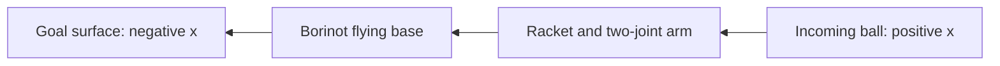

# Borinot goalkeeper — first Isaac Lab prototype

Date: 2026-10-14. Task ID: `Borinot-Goalkeeper-Direct-v0`.

## Start here

This is a separate task. It does not change the existing Borinot locomotion task or the source USD.
We start with privileged simulator information. Both the actor and critic receive true robot state, ball position and velocity, and the sampled ball mass and restitution. There is no camera or state estimator yet.

The default reward follows Jordi's requested approach. Goal and base hits cost −1. Arm hits cost −0.25. Leaving the goal area costs −1. Moving the racket closer to the ball in the goal-parallel plane earns signed progress. A verified racket save earns +1. Additional shaping and the recovery requirement are off by default.

Use **PPO** first. Both Borinot tasks now share the Solo-style PPO recipe: 24 rollout steps, four minibatches, five epochs, `[512, 256, 128]` networks, AdamW, and gamma 0.99. See [PPO training guide](../borinot/PPO_TRAINING.md) for the complete cluster commands and available flags. SAC remains future work.

### Activate the local environment

Run this once in your terminal:

```bash
cd /home/jordibelp/IsaacLab && source /home/jordibelp/miniconda3/etc/profile.d/conda.sh && conda activate env_isaaclab && export SSL_CERT_FILE=/etc/ssl/certs/ca-certificates.crt SSL_CERT_DIR=/etc/ssl/certs CURL_CA_BUNDLE=/etc/ssl/certs/ca-certificates.crt
```

### Train on the laptop

```bash
./isaaclab.sh -p source/scripts/rsl_rl/train.py --task Borinot-Goalkeeper-Direct-v0 --num_envs 512 --max_iterations 10000 --headless --logger tensorboard '--kit_args=--/UJITSO/geometry=false --/UJITSO/textures=false --/UJITSO/materials=false'
```

The task's default environment count is 2048. The command starts smaller on the laptop's 8 GB GPU. Increase it after checking memory use.
For an initial visible simulation, omit `--headless` and use fewer environments. GUI rendering has not been verified in this task's headless validation.

### Train at your usual scale

On IRICluster, activate its `isaaclab` conda environment first. After you have pulled the local code commit, use the same command with `--num_envs 10000`. We did not sync code or submit a cluster job. Ten thousand environments have not been benchmarked for this task.

### Optional W&B logging

Replace `--logger tensorboard` with `--logger wandb --log_project_name borinotIsaacLab`.
The earlier control checks used local TensorBoard only. The PPO recipe checks also exercise offline W&B, which does not upload a run.

### Play a checkpoint

Use the dedicated goalkeeper player. The Solo12-specific `source/scripts/rsl_rl/play_direct_0325.py` is not compatible with this task. See [playback and camera guide](PLAY.md) for the first trained checkpoint command, camera views, and evaluation settings.

Replace `/absolute/path/model_N.pt` with your actual checkpoint:

```bash
./isaaclab.sh -p source/scripts/rsl_rl/play_borinot_goalkeeper.py --num_envs 1 --checkpoint /absolute/path/model_N.pt 'env.robot_home=[0.0,0.0,1.5]' env.shot_level=0
```

The play command uses the current source configuration, not an automatic reconstruction of an old run. Match the training options and network sizes when comparing policies. Playback and the checkpoint smoke script load policy weights without restoring optimizer state, so the shared AdamW training checkpoints do not conflict with the playback runner's default Adam groups.

## 1. Scene and physical model

The local environment uses these coordinates:

- **x:** shot direction. The ball starts near x = 2 m and moves toward negative x.
- **y:** sideways across the goal.
- **z:** height above the floor.
- The goal is a solid rectangular surface centered at x = −0.45 m. Its width and height are 2.4 m.
- Borinot starts with its base at `(0, 0, 1.5)` m.
- At the reference home height of 1.5 m, the neutral racket center is approximately `(−0.0303, −0.0647, 1.1293)` m.
- The body starts at −90° yaw. The arm swings in the goal's Y–Z plane, and the paddle's broad face is parallel to that plane. Both joints can move the paddle across the goal without turning it edge-on to an incoming ball.
- The progress plane is y–z, parallel to the goal. Forward motion along x alone earns no progress.



The robot comes from:

```text
/home/jordibelp/IsaacLab/source/isaaclab_assets/data/Robots/Borinot/borinotFlat.usd
```

### Paddle and mass

The original USD has a 115 g distal link. We model it as a 15 g shaft plus a separate 100 g paddle. This is a prototype interpretation of the existing tip ballast, not a measured separation of the physical parts.
The paddle is a rigid cuboid: 12 mm thick, 240 mm wide, and 240 mm high. A fixed joint connects it to the distal link. Its center has a 50 mm standoff from the old tip center along the arm-plane normal, toward the incoming ball. The local mount rotates the paddle's +X normal onto the distal link's +Z axis. The root yaw then maps this normal onto world +X. The original USD is unchanged.

The task changes mass, center of mass, and inertia in the spawned USD layer only. It never saves over the original file. The shaft inertia uses a simple 160 mm rod approximation. PhysX computes the paddle inertia from its cuboid geometry and mass. Total robot mass remains **2.910538 kg** in the simulator.

The old distal mesh remains visible and collidable. A ball hitting it counts as an arm hit, not a paddle hit. The paddle's new mass distribution is intentionally different from the old ballast's distribution, even though the total mass is unchanged.

### Ball and contacts

The ball has a 30 mm radius. Each reset samples mass uniformly from 20–50 g and restitution from 0.35–0.65. Restitution means how strongly the ball rebounds. We use the `max` material combination rule with a zero-restitution paddle, so the sampled ball value sets the ball–paddle restitution.

When mass changes, the code also changes the sphere's inertia using `I = 0.4 * mass * radius²`. The property setters change the active PhysX model, not just USD metadata. Validation reads those properties back.

Physics defaults to 200 Hz. The policy defaults to 100 Hz. Both rates are configurable; see section 3. Contacts are inspected after **every physics substep**, not only after policy steps. A ball-source contact sensor has separate filters for the paddle, base, upper arm, lower arm, goal, and floor. Each environment has its own floor and goal, including at large environment counts.

GPU PhysX does not support ordinary swept CCD in this runtime. The task uses speculative CCD and a swept geometric goal-plane check. These do not establish accurate real impact dynamics. Smaller physics steps and contact-parameter sensitivity tests are still needed before hardware transfer.

There is no ball drag, wind, racket compliance, or camera latency model yet.

## 2. Reward and episode endings, term by term

Every reward weight uses `rwd_scale_*`. The code adds `scale * signal`: **negative scales penalize**, and **positive scales reward**. Setting a scale to zero removes that reward contribution. It does **not** disable the event detector or its episode reset.

Here, **racket** and **paddle** mean the same separate rigid body. A **live shot** is a ball that has not yet met the safe-clearance conditions. A paddle touch alone does not make the ball safe.

The tables below give the shipped values in the committed config. **Current local tuning on 2026-10-14 differs:** `rwd_scale_energy=-0.0001`, `arm_copper_loss_coefficient=6.888`, `clear_speed_m_s=0.2`, and `robot_home=(0.0, 0.0, 0.5)`. Energy is therefore enabled in the current working file. Its home height is also below the allowed minimum of 0.55 m; see the area explanation below. These locally tuned values are preserved. Hydra overrides can change them again at launch.

### How one policy step gets its reward

With the default 200 Hz physics and 100 Hz policy, one action lasts two physics steps and `step_dt=0.01 s`. We check contact and safety events after every physics step. An event remains recorded until the end of that action interval, even if the contact has already ended. Paddle-hit and safe-clearance history remain recorded until the episode resets.

At the end of the interval, we select an outcome, calculate the reward, and then reset any finished environment. The total reward is:

```text
reward = plane_progress + outcome + floor_after_save
         + optional_rates + optional_hit + energy
```

`outcome` contains **one** selected event reward, not the sum of all detected failures. The other five components are added separately. Progress, event rewards, first-hit bonuses, and the mean-power term have **no extra dt multiplier**. Only `optional_rates` is multiplied by `step_dt`. Sections 2 and 5 define every signal in this sum.

### Main reward scales

| Config field | Shipped scale | Signal and usual episode effect |
|---|---:|---|
| `rwd_scale_goal` | −1.0 | Ball contacts or crosses the goal surface. Ends the episode. |
| `rwd_scale_ball_base_collision` | −1.0 | Ball contacts the aircraft base. Ends the episode. |
| `rwd_scale_ball_arm_collision` | −0.25 | Ball contacts either arm link, rather than only the paddle. Ends the episode. |
| `rwd_scale_leave_goal_area` | −1.0 | Base origin leaves the allowed box. Ends the episode. |
| `rwd_scale_save` | +1.0 | A paddle hit is followed by verified safe clearance, plus recovery if requested. Ends the episode. |
| `rwd_scale_ball_floor` | −0.25 | Ball touches the floor while live. Usually ends the episode; a valid floor save is the exception. |
| `rwd_scale_miss` | −1.0 | An unresolved ball leaves the tracking bounds. Ends the episode. |
| `rwd_scale_deadline` | −1.0 | Shot time runs out without a confirmed save. Ends the episode. |
| `rwd_scale_robot_crash` | −1.0 | Non-ball robot contact or excessive tilt. Reset depends on two independent switches. |
| `rwd_scale_progress` | +0.5 | Signed reduction in paddle-to-target y–z distance, in metres. Does not end the episode. |

Each selected event has signal 1, so its contribution is exactly its scale. For example, a selected arm collision contributes −0.25, not −0.25 per second. With the default reset switches, event penalties end the episode and are paid on that final transition. Crash penalties can repeat if you disable their resets.

### `rwd_scale_goal`: the ball scores

A goal is detected in either of two ways:

- The ball's filtered contact force against the goal exceeds `contact_force_threshold_n=0.05 N`.
- The ball crosses the front goal plane toward negative x and overlaps the goal in both y and z. The crossing test checks the path between consecutive physics samples, so it can detect a fast ball that crosses between them.

The crossing plane is `goal_center.x + goal_size.x/2 + ball_radius_m`, currently **x = −0.40 m**. This is the plane reached by the ball's center when its leading edge reaches the goal front. The y–z overlap includes the 0.03 m ball radius; an edge-overlapping ball still counts as a goal. A prior paddle touch does not cancel a later goal. A goal is a failed save and ends the episode.

### `rwd_scale_ball_base_collision` and `rwd_scale_ball_arm_collision`: forbidden ball contacts

These use the same 0.05 N filtered ball-contact threshold. A base hit means contact with `base`. An arm hit means contact with `flying_arm_2__link1` or `flying_arm_2__link2`. Both end the episode, even if the collision stops the ball from scoring.

The attached paddle is a separate body and is the only legal hitting surface. The original distal-link mesh remains collidable and counts as an **arm**, not as the paddle. A paddle touch and an arm touch in the same interval still constitute an arm-hit failure. These penalties have independent scales; changing the goal scale does not change them.

### `rwd_scale_ball_floor`: ball-to-floor contact, with or without a paddle hit

This term is **not** a penalty for hitting the ball twice. It concerns the **ball touching the floor**. We detect it when the filtered ball/floor force exceeds 0.05 N, or when the ball center has `z <= ball_radius_m + 0.001` (currently **0.031 m**).

There are three important cases:

1. **No paddle hit, then floor:** this is a live-floor failure. It receives −0.25 and ends the episode. It earns no save bonus.
2. **Paddle hit, then floor while still unresolved:** if the ball lands with its center **in front of the goal plane** (`x > −0.40 m`) and no safety/forbidden-contact failure prevents clearance, it qualifies as a save. With default recovery off, it receives +1 for the save **and** −0.25 for the floor: **+0.75** before other terms. An unresolved floor landing that does not qualify receives the floor failure instead.
3. **Ball already safely cleared, then floor in a later interval:** the floor detector ignores that out-of-play contact. There is no new floor penalty. With recovery off, the episode has already ended anyway.

In case 2, the floor cost is logged as `floor_after_save`, rather than replacing the save in `outcome`. If clearance is confirmed in an interval that has already recorded a live-floor contact, that floor cost is still paid in the interval. With recovery required, it can be paid while recovery is pending (`outcome=0`), with the save bonus paid later. It is not paid again after clearance. Higher-priority failures suppress this separate floor-after-save reward component; see the priority list below.

### `rwd_scale_miss`: unresolved ball escapes the tracking region

The exact escape test uses the ball center in environment-local coordinates:

```text
abs(ball.x) > 3.0 m, OR abs(ball.y) > 3.0 m, OR ball.z > 4.5 m
```

If any bound is exceeded **before safe clearance**, the miss flag is set. There is no separate lower-z escape bound; floor detection handles low balls. These escape limits are literal values in `_sample_physics_events()`, not config fields.

For example, a ball at y = 3.1 m without verified clearance receives −1 and ends the episode, unless another failure has higher priority. A ball at that same position after a valid paddle clearance does not incur a miss penalty. A ball passing beside the goal **without touching the paddle** is not automatically a save: it stays unresolved until a floor event, escape, or deadline ends the shot. Thus `miss` means an out-of-bounds unresolved shot, not every unsuccessful interception.

### `rwd_scale_deadline`: the shot clock expires

Each reset starts a separate shot clock at zero. It advances once per policy action. The limit is `ceil(episode_length_s / step_dt)`: **300 actions = 3.0 s** with the default 100 Hz policy. It is independent of the runner's randomized initial episode-length counter.

If the shot reaches that limit without a confirmed save, it receives the deadline outcome, unless a higher-priority failure occurred. For example, a touched but still unresolved ball inside the tracking bounds at 3 s receives −1. With recovery required, safe ball clearance without completing the recovery dwell by 3 s also receives −1.

A save completed on the last allowed action does not receive the deadline penalty. The deadline is a **real task failure**, not just a cut in a longer trajectory: `terminated=True`, with no timeout truncation or PPO timeout bootstrap. To change its time, tune `episode_length_s`, not `rwd_scale_deadline`. To change only its reward amount, tune the scale. Setting that scale to zero still ends the episode at the deadline.

### `rwd_scale_leave_goal_area`: the aircraft base leaves its box

The test uses the **base origin**, not the paddle position or the outer edges of the robot. Coordinates remove the environment's world offset. The allowed inclusive bounds are:

```text
x: [-0.08, 0.90] m
y: [-1.20, 1.20] m
z: [ 0.55, 2.60] m
```

Any sampled base coordinate strictly below its minimum or above its maximum sets the area flag, even if the base returns inside before the policy interval ends. The selected area outcome costs −1 and ends the episode. Tune `goal_area_x_m`, `goal_area_y_m`, and `goal_area_z_m` to change the box. The racket may extend outside it without causing this particular penalty.

Both spawn and reset use `robot_home_quat` in wxyz order. Reset position is `robot_home`, plus noise of up to 0.015 m on each axis. Changing home does **not** move the allowed box or the fixed ball-target center. In the current locally tuned file, home z = 0.5 m gives reset z in [0.485, 0.515] m, all below the allowed minimum. This can trigger an area failure immediately, without the robot first moving away from home. The committed 1.5 m reference home does not have this mismatch.

### `rwd_scale_robot_crash`: non-ball contact or excessive tilt

Two independent detectors share this reward scale:

- **Robot contact:** on the base, either arm link, or paddle, we remove the ball's equal-and-opposite filtered normal force from the robot's net contact force. A remaining force magnitude above **0.1 N** on any of these bodies sets the contact-crash flag. This distinguishes a legal ball/paddle impact from a robot hitting the floor or another scene surface. The 0.1 N limit is literal in the code.
- **Tilt:** the base's up axis tilts from world vertical by more than `robot_tilt_threshold_degs`, **70 degrees** by default. This setting is in degrees; the detector converts it internally with `math.radians()` before taking the cosine. At 69 degrees the tilt detector does not fire; at 71 degrees it does. This does not require a collision. Pure yaw does not trigger this test. For example, append `env.robot_tilt_threshold_degs=70.0` to a launch command. The old `robot_tilt_threshold_rad` field is no longer used.

`reset_robot_on_robot_crash=True` ends the episode for the contact detector. `reset_robot_on_tilt_threshold=True` ends it for the tilt detector. Setting either to `False` disables **only that detector's reset**, not its reward or the other detector. A persistent violation can therefore receive −1 in every action interval. If both detectors fire in one interval, they still select one crash outcome, not two penalties.

Other endings, such as a goal, leaving the box, or the deadline, still reset the episode. Contact/tilt violations also prevent new safe-clearance confirmation even when their resets are disabled. Extras `goalkeeper_robot_contact_crash` and `goalkeeper_tilt_threshold` expose the two causes separately.

### `rwd_scale_save`: contact plus safe clearance, not contact alone

A save first requires a real PhysX **paddle contact** above 0.05 N. Proximity alone is insufficient. After that contact, one of these conditions must confirm that the ball is clear:

1. **Returned toward the shooter:** ball center `x > keeper_plane_x + clear_distance_m`, currently about **0.2197 m**, and x velocity `> clear_speed_m_s` (0.3 m/s shipped; 0.2 m/s in your current local tuning). Here `clear_distance_m=0.25 m` is measured from the defense plane, not from the goal.
2. **Deflected outside the goal:** ball center `x < −0.40 m` and outside the radius-expanded goal bounds in **either** y or z. The checks are `abs(y-goal_center.y) > goal_size.y/2 + ball_radius_m` or the equivalent z test. At the shipped dimensions, these are `abs(y) > 1.23 m` or `abs(z-1.2) > 1.23 m`.
3. **Deflected onto the floor in front of the goal:** a live-floor event after the paddle hit, with ball center `x > −0.40 m`. This keeps the separate floor cost described above.

New clearance is rejected if the interval contains a base/arm hit, goal, nonqualifying floor event, robot contact crash, excessive tilt, or leaving the area. Contact and clearance may occur in the same policy interval or in different intervals. Clearance stays recorded once confirmed.

With `require_recovery_for_save=False`, clearance is enough for success: +1 and an episode ending. With it set to `True`, the robot must also complete the recovery dwell described in section 5 before the deadline. A paddle touch followed by a goal **before clearance** is a failure. The default does not continue simulating the ball after a confirmed save, so it does not evaluate later play or long-term robot stability.

### `rwd_scale_progress`: bring the paddle closer in the goal-parallel plane

We use only y and z, ignoring depth x. At the end of an action interval, we measure the previous and current paddle centers against the **same current ball target**:

```text
d_before = distance(previous paddle yz, current ball yz)
d_after  = distance(current paddle yz, current ball yz)
progress = rwd_scale_progress * (d_before - d_after)
```

Distances are Euclidean distances in metres. Reducing distance from 0.30 m to 0.20 m earns `0.5 * 0.10 = +0.05`. Moving away by 0.10 m earns −0.05. Changing only x earns zero. A stationary paddle earns zero even when the ball moves, because both distances use the same target.

The active mask is taken **at the start** of the interval. It requires no previous paddle hit, ball x velocity `< −0.1 m/s`, and ball x `> goal_center.x` (−0.45 m). This means progress can still be paid in the interval containing the first hit or a terminal failure. It stops in following intervals after the first paddle hit. Resets start a new distance comparison; there is no progress jump between episodes.

`progress_use_prediction=True` replaces the current-ball target with its ballistic defense-plane prediction. It does not change the y–z-only distance or this start-of-interval mask. Unlike the optional intercept kernel, progress has no extra prediction-validity mask. This is practical moving-target shaping, not a guarantee of policy invariance.

### If several events happen together: exact priority

The selected `outcome` uses this order, from **highest to lowest** priority:

```text
base hit > goal > robot crash/tilt > leave area > arm hit
         > live-floor failure > miss/escape > deadline > save > ongoing
```

For example, a simultaneous base hit and goal selects only the base penalty. A simultaneous arm hit and goal selects only the goal penalty. A floor failure at the deadline selects only the floor penalty. A detected failure suppresses a save bonus in the same interval.

This priority selects the **reward label**. Episode ending is checked separately against all active ending conditions. With crash resets disabled, for example, crash can be the selected reward while a simultaneous deadline still ends the episode. A valid floor save is not a live-floor failure; its floor cost is the separate `floor_after_save` addition. Progress, enabled rate terms, and energy can also contribute on a failure transition.

| Example with shipped scales | Event subtotal, before progress/rates/energy |
|---|---:|
| Paddle hit, then safely returned toward shooter | +1.00 |
| Paddle hit, then valid floor save | +0.75 |
| Floor while unresolved, no paddle hit | −0.25 |
| Paddle touch, then goal before clearance | −1.00 |
| Ball stops scoring because it hits an arm | −0.25 |
| Simultaneous base hit and goal | −1.00, not −2.00 |
| Unresolved escape beyond y = 3 m | −1.00 |
| Unresolved shot still inside tracking bounds at 3 s | −1.00 |

Optional hit rewards paid in an **earlier** interval are not refunded if the ball later scores. Section 5 explains their same-interval failure mask. The examples above have those optional hit scales at zero.

### Tune the main reward

Append float overrides to the training command, for example:

```bash
env.rwd_scale_progress=1.0 env.rwd_scale_save=1.5 env.rwd_scale_goal=-1.0 env.rwd_scale_ball_base_collision=-1.0 env.rwd_scale_ball_arm_collision=-0.4 env.rwd_scale_leave_goal_area=-1.0 env.rwd_scale_ball_floor=-0.25 env.rwd_scale_miss=-1.0 env.rwd_scale_deadline=-1.0
```

Use floats such as `1.0` for float config fields. The defaults are starting values, not an optimized recipe. To discourage arm blocking more strongly, make `rwd_scale_ball_arm_collision` more negative. To recover the shipped reward from the current locally tuned energy setting, also pass `env.rwd_scale_energy=0.0`.

## 3. Select control mode, timing, and joint actuator settings

Use `env.control_mode` as a Hydra override on the training or playback command. Names are case-sensitive. The default is `thrust_and_torque_control`.

| `env.control_mode` | Policy actions | Actor / critic values |
|---|---:|---:|
| `thrust_and_torque_control` | 6 individual thrusts + 2 joint torques: **8** | **57** each |
| `thrust_and_PD_joint_pos_control` | 6 individual thrusts + 2 desired joint angles: **8** | **57** each |
| `PI_rotors_PD_joint_pos_control` | Collective thrust + 3 body rates + 2 desired joint angles: **6** | **55** each |

Append one of these selectors to the training command:

```bash
env.control_mode=thrust_and_torque_control
```

```bash
env.control_mode=thrust_and_PD_joint_pos_control
```

```bash
env.control_mode=PI_rotors_PD_joint_pos_control
```

### Physics and policy frequency

Defaults are **200 Hz physics / 100 Hz policy**, in every mode. These are independent of the control-mode choice:

```bash
env.physics_hz=200 env.policy_hz=100
```

The physics frequency must be an integer multiple of the policy frequency. At 200/100 Hz, each action spans two physics steps. For the former PI timing, use:

```bash
env.control_mode=PI_rotors_PD_joint_pos_control env.physics_hz=240 env.policy_hz=60
```

The task resolves `sim.dt=1/physics_hz`, `decimation=physics_hz/policy_hz`, render interval, and action/observation dimensions after Hydra overrides and before creating the simulator. Use these frequency selectors rather than overriding the derived `env.sim.dt` or `env.decimation`; the selectors take precedence. Invalid names or frequency ratios fail before environment construction. Rates are integer config fields; write `200`, not `200.0`.

Changing rates also changes the number of actions in a shot. The three-second deadline becomes 300 actions at 100 Hz or 180 at 60 Hz. Contact detection and power sampling still run after every physics substep. Rate rewards use the resolved policy timestep. `curriculum_min_steps` still counts policy steps, so its physical dwell changes with policy frequency. No reward scales or PPO discount settings are automatically retuned.

### Direct rotor modes: a and b

All policy actions are clipped to `[-1, 1]`. Actions 0–5 independently request thrust from rotors 0–5:

```text
requested rotor thrust = hover_per_rotor * (1 + rotor_action_scale * action)
hover_per_rotor = simulated robot mass * 9.81 / 6
```

With `rotor_action_scale=1.0` and `thrust_to_weight=2.0`, action −1 requests zero thrust, action 0 requests nominal per-rotor hover thrust, and action +1 requests twice that thrust. Commands are clipped to `[0, thrust_to_weight * hover_per_rotor]`. Unlike the old locomotion run's below-hover cap, this default provides nominal flight thrust reserve.

There is **no body-rate PI feedback** in either direct mode. The rotor geometry maps the individual forces to the resulting base force and torque. The physical response still uses a first-order thrust filter with `motor_time_constant_s=0.04`. Zero thrust actions request nominal hover thrust, but do not stabilize position or attitude on their own. These are simulator assumptions, not calibrated ESC or motor limits.

In mode **a**, actions 6–7 request shoulder and elbow torques:

```text
joint torque target = effort_lim_sim * action
```

The default range is ±2.7 N·m per joint. Joint drive stiffness and damping are both zero: no position PD is added to the policy torque.

In mode **b**, actions 6–7 request two scalar joint angles:

```text
shoulder angle target = 1.1 * action[6] rad
elbow angle target = 1.4 * action[7] rad
```

These are absolute targets relative to joint zero, not increments. The ranges are ±63.0 degrees and ±80.2 degrees. Implicit joint PD follows them with zero desired joint velocity and zero feedforward effort. Unlike the old locomotion interface, two desired angles use two policy outputs, not four atan2 inputs.

### PI rotor mode: c

This keeps the previous action mapping:

| Index | Meaning |
|---:|---|
| 0 | Collective thrust around hover: `weight * (1 + 0.7 * action)` |
| 1–3 | Body-rate targets, scaled by `(2.0, 2.0, 1.5)` rad/s |
| 4–5 | Shoulder and elbow angle targets, scaled by `(1.1, 1.4)` rad |

At each physics step, the PI controller computes rate error, updates its bounded integral, and requests base torque. A six-rotor allocation matrix converts collective thrust and torque into individual thrust commands. The same thrust clipping and motor-response filter apply. The limb uses the same PD settings as mode b. The PI gains remain `rate_kp` and `rate_ki`; they do not affect modes a or b.

### Solo-style joint actuator

Every mode uses `ImplicitActuatorCfg`, with **armature 0.00036207**, joint friction 0.0, default velocity limit **100 rad/s**, and default effort limit **2.7 N·m**. Armature represents the motor/gear inertia reflected at the joint. The armature matches the Solo actuator configuration, because Borinot uses Solo joint motors.

Configure limits and the position-mode PD gains through Hydra:

```bash
env.effort_lim_sim=2.7 env.velocity_lim_sim=100.0 env.joint_stiffness=35.0 env.joint_damping=0.6
```

These four fields are floats. The task refreshes limits and gains on the existing actuator before spawn, without replacing its friction or armature settings. Torque mode ignores the PD gains unless `hold_arm=True`. In every mode, `hold_arm=True` means neutral-position PD and zero feedforward torque; it is **not** a mechanically welded limb.

### Observation and checkpoint contract

Actor and critic each receive the same 49 shared values plus the current policy actions: 57 values in direct modes or 55 in PI mode. Shared values include the home-position error, full root quaternion, base linear and angular velocities, joint positions and velocities, relative paddle position and normal, relative ball position and velocity, predicted intercept/time/validity, shot phase/time, rotor thrust state, controller integral, and sampled ball mass/restitution. The three PI-integral entries remain zero in direct modes. Joint velocity is divided by `velocity_lim_sim`.

The predicted intercept is privileged information. It does not replace the current-ball target in the default progress reward. All coordinates remove the clone's world offset. The finite shot clock is independent of the generic runner's randomized initial episode-length counter.

Always match the control mode, rates, action scales, and actuator settings when loading a checkpoint. Direct and PI checkpoints have different shapes. Modes a and b have equal shapes but different action meanings; do not interchange their checkpoints merely because loading succeeds. Older PI checkpoints also used a different joint-velocity normalization, velocity limit, and armature. Existing locomotion checkpoints are not compatible with these goalkeeper observations.

## 4. Difficulty and curriculum

Every shot is ballistic and aimed at the defense plane. Tests check that unblocked shots also threaten the goal and do not hit the floor first. This avoids training on harmless throws.

| Level | Sideways target range around the neutral racket | Height range | Flight time to defense plane |
|---:|---:|---:|---:|
| 0 | ±0.045 m | ±0.045 m | 0.42–0.50 s |
| 1 | ±0.20 m | ±0.12 m | 0.35–0.50 s |
| 2 | ±0.40 m | ±0.22 m | 0.30–0.46 s |
| 3 | ±0.65 m | ±0.32 m | 0.25–0.42 s |

These are uniform target offsets around the configured center. Level 0 is intentionally easy: neutral hovering can cover its small spread. It checks geometry and flight stability, not agile goalkeeping.
The sampling checks prove that throws threaten the goal, not that Borinot can reach every throw. Some fast, wide level-3 shots may be dynamically unreachable. Check that limit before interpreting a learning plateau. The two arm joints mainly move the tip in the body's x–z plane; sideways coverage also needs aircraft motion or reorientation.

Automatic promotion uses the last up-to-2048 completed episodes from the current level. It requires at least 1024 completed episodes, a save fraction strictly above 0.7, and 3000 policy steps at that level. The latter is **30 simulated seconds per environment at 100 Hz**, or 50 seconds at 60 Hz. More environments increase sample count, not elapsed simulated time.

A shot keeps its starting level until it ends. Older-level endings are excluded from the new level's decision window. Promotion clears that window. An empty batch cannot promote. General outcome counts still include every completed shot.

For a fixed-level experiment, append:

```bash
env.curriculum=False env.shot_level=2
```

Checkpoint resume restores the policy and optimizer, but the standard runner does not save this environment's curriculum window or active level. Set `env.shot_level=N` explicitly when resuming a later level. The dwell and evidence window restart. Do not infer restored curriculum state from the checkpoint iteration number.

### Best checkpoint per level

`source/scripts/rsl_rl/train.py` keeps one best checkpoint per shot level in the run folder: `best_model_curriculum_idx_0.pt` to `best_model_curriculum_idx_3.pt`. "Best" means the highest `Train/mean_reward`. This is the mean return of the last 100 finished episodes. `best_model.pt` is a copy of the most recently improved level best. Each file stores its level, iteration, and score in the checkpoint `infos`.

A promotion does not end the shots already in flight. For a few iterations, the finished episodes still come from the old, easier level. Their return must not count as the new level's score. The environment therefore counts the newest finished episodes that started at the current level (`curriculum_stage_pure_episodes`). The script skips a level's best-checkpoint update until this count covers the whole 100-episode reward buffer. In a local check, this skipped two or three iterations after each promotion. Without the skip, a level-2 score would have become the level-3 best.

With `env.curriculum=False`, the file is named after the fixed `env.shot_level`.

## 5. Optional additions — off by default

All ten optional scales ship as zero. They are separate experiments, not required parts of the main objective. Your current local file enables energy only, as noted in section 2. A **dense** reward means feedback on many policy steps, rather than just at a shot outcome.

### `progress_use_prediction`: change the progress target, not its scale

This switch is `False` by default. Setting it to `True` makes progress aim at the ball's predicted intersection with `keeper_plane_x`, rather than its current position. The prediction assumes gravity of 9.81 m/s² and no drag or future collisions:

```text
t = (keeper_plane_x - ball.x) / ball.vx
target = ball.position + ball.velocity * t
target.z -= 0.5 * 9.81 * t²
```

The helper reports a valid prediction only when `ball.vx < −0.1 m/s`, the ball is in front of the defense plane, and its time to that plane lies in [0, 1] s. It clamps the returned prediction time to [0, 1] s; the denominator is bounded at −0.1 m/s to avoid a near-zero division. Progress uses the returned target even when the validity flag is false. The two optional rewards below do respect that flag.

### `rwd_scale_intercept`: stay near the predicted interception point

This adds a positive rate reward when the paddle center is near the predicted ball center. Unlike progress, it measures **full 3D distance**, including x:

```text
d_3d = distance(current paddle center, predicted ball center)
K = exp(-(d_3d / intercept_sigma_m)²)
intercept reward = rwd_scale_intercept * K * step_dt
```

`K` is set to zero unless the prediction is valid and the ball has **not yet touched the paddle**. These conditions are evaluated at the end of the interval. The shipped width is `intercept_sigma_m=0.30 m`. At d = 0, K = 1; at d = 0.30 m, K is about 0.368. If the scale is 0.1, a perfect match contributes `0.1/100 = +0.001` per action at the default 100 Hz, not +0.1 per action. It rewards being close even without motion, so it is different from signed progress. It does not itself prove contact or a save.

### `rwd_scale_alignment`: orient the paddle face toward the incoming ball

This uses the same valid, pre-hit kernel `K`, then multiplies it by a squared dot product:

```text
direction = -ball.velocity / max(norm(ball.velocity), 0.1 m/s)
A = dot(paddle face normal, direction)²
alignment reward = rwd_scale_alignment * K * A * step_dt
```

The face normal is the paddle's local +x axis rotated into world coordinates. At normal shot speeds, A is 1 for a face perpendicular to the flight direction, and 0 for a face edge-on to it. Squaring means the normal and its opposite get the same value: this term does not choose a front versus back face. Below 0.1 m/s, the bounded denominator reduces the magnitude of A. The kernel prevents a distant but well-oriented paddle from getting the full reward.

### `rwd_scale_hit` and `rwd_scale_centered_hit`: reward the first paddle touch

These are **event bonuses**, not rates. They are paid only on the first detected paddle hit of an episode, and only if the selected outcome in that interval is ongoing (0) or save (7):

```text
Q = exp(-(u² + v²) / (0.09 m)²)
first-hit reward = rwd_scale_hit + rwd_scale_centered_hit * Q
```

`u` and `v` are the ball center's offsets along the paddle face, in the paddle's own coordinates, at first contact. Paddle thickness/depth is ignored. Q is 1 at the center and decreases toward the edges. The 0.09 m width is fixed in `_sample_physics_events()`; it is not `intercept_sigma_m`.

For example, with hit scale 0.1 and centered-hit scale 0.2, a centered first contact earns +0.3. A second paddle contact earns no new bonus. A first paddle hit accompanied by a selected arm/base/goal/safety/deadline/miss failure earns neither bonus. **A bonus already paid on an earlier interval is not taken back if the ball later scores.** These terms encourage contact discovery, not verified saves, so keep them separate from `rwd_scale_save`.

### `require_recovery_for_save`: an optional success gate

This is a boolean, not a reward scale. It is `False` by default. Setting it to `True` keeps the shot running after clearance and withholds the save bonus until the robot passes all five checks:

| Quantity | Required value at each policy-step check | Config field |
|---|---:|---|
| 3D base distance from `robot_home` | < 0.35 m | `recovery_position_tolerance_m` |
| Base linear speed | < 0.5 m/s | `recovery_speed_m_s` |
| Base angular speed | < 0.8 rad/s | `recovery_angular_speed_rad_s` |
| Tilt from world vertical | < 0.35 rad, about 20 degrees | `recovery_tilt_rad` |
| Largest absolute arm joint angle from zero | < 0.5 rad | `recovery_joint_tolerance_rad` |

The conditions must hold at consecutive policy-step checks for `recovery_dwell_s=0.25 s`, or 25 actions at the default 100 Hz (15 at 60 Hz). The timer is zero before clearance and resets to zero if any check fails. It measures return toward neutral arm angles, not toward the previous action's targets. There is no separate yaw-angle recovery test. Safety and the three-second deadline remain active during recovery.

This gate works even with `rwd_scale_recovery=0.0`. Conversely, enabling the recovery reward below does not turn on the gate. With the default gate off, the episode ends at clearance, so there is no multi-step post-clearance recovery period.

### `rwd_scale_recovery`: smooth feedback after clearance

This adds a rate reward after the ball is safely cleared. It does not require the hard recovery checks to be satisfied:

```text
S = exp(-(distance_home / 0.35 m)² - (linear_speed / 0.5 m/s)²
        - (angular_speed / 0.8 rad/s)² - (tilt / 0.35 rad)²
        - (largest_absolute_joint_angle / 0.5 rad)²)
recovery reward = rwd_scale_recovery * S * step_dt, only after clearance
```

S is 1 at a stationary, level, neutral-arm home state and decreases as any error grows. **These five widths are fixed in `_recovery_geometry()`**. Changing the configurable gate thresholds above does not change this smooth score. With recovery required, it can guide the robot over several post-clearance steps. Without the gate, it can contribute on the clearance/terminal step only.

For a recovery experiment, append:

```bash
env.require_recovery_for_save=True env.rwd_scale_recovery=0.1
```

### Motion and control regularizers

A regularizer discourages unwanted motion or control changes. Each signal below is nonnegative. Use a **negative** scale to penalize it. These terms are evaluated at the end of every action interval, including terminal intervals, and are not limited to the incoming-ball phase.

| Config field | Raw signal; contribution is `scale * signal * step_dt` | What it discourages |
|---|---|---|
| `rwd_scale_action_rate` | `sum((current_action - previous_action)²)` over all clipped policy actions (eight in direct modes, six in PI mode) | Abrupt action changes. This is a step-to-step difference, **not divided by dt**. The previous action is zero after reset. |
| `rwd_scale_body_angular_velocity` | `sum(base_angular_velocity_body_frame²)`, in (rad/s)² | Fast base rotation. All three axes count, including yaw. |
| `rwd_scale_body_linear_velocity` | `sum(base_linear_velocity_world_frame²)`, in (m/s)² | Fast aircraft translation in any direction. |
| `rwd_scale_thrust` | `mean((applied_rotor_thrust / nominal_hover_thrust_per_rotor - 1)²)` over six rotors | Thrust departing from its nominal hover allocation. Applied thrust includes motor lag. |

For example, changing just one clipped action by 0.2 gives an action-rate signal of 0.04. With scale −0.1, its contribution is `−0.1 * 0.04 / 100 = −0.00004` at the default 100 Hz. The action-rate signal still includes the two arm outputs when `hold_arm=True`, although those outputs are ignored by the arm controller.

The thrust signal is zero at nominal hover thrust. It is **not a physical power estimate**: hovering consumes power but pays no thrust regularizer. It also penalizes reducing thrust below nominal hover, not only increasing it above hover.

### `rwd_scale_energy`: mean mechanical plus dissipative power

Despite its name, this term uses **mean power in watts**, not integrated energy in joules. We sample every completed physics step (two per action by default), including the final step before an automatic reset:

```text
energy reward = rwd_scale_energy * mean_over_physics_steps(P_total)
P_total = P_rotor_mechanical + P_rotor_dissipative
          + P_arm_mechanical + P_arm_copper_loss
```

There is **no extra `step_dt` multiplier**. At a mean estimate of 500 W, your local scale −0.0001 contributes −0.05 per policy action. Setting the scale to 0.0 disables this reward without disabling the power measurements.

For each physics sample, the model is:

```text
rotor_speed_i = sqrt(applied_thrust_i / kf)
P_rotor_mechanical = sum(km * rotor_speed_i³)              # six rotors
P_rotor_dissipative = P_rotor_mechanical * (1/efficiency - 1)
P_arm_mechanical = sum(joint_torque_j * joint_velocity_j)  # two joints
P_arm_copper_loss = arm_copper_loss_coefficient * sum(joint_torque_j²)
```

`efficiency` is `p_el_motor_efficiency=0.95`. Thus total rotor power equals rotor mechanical power divided by 0.95. Applied thrust includes the motor's first-order lag, rather than using the raw commanded thrust. Joint torque is `robot.data.applied_torque`: a clipped implicit-actuator PD estimate, **not measured PhysX drive torque**.

Joint mechanical power is signed. Driving with the motion adds power; braking against the motion subtracts it. Copper loss is nonnegative, including when holding a stationary joint under torque. The coefficient has units W/(N·m)²: it ships as 7.0 and is 6.888 in your locally tuned file. `kf`, `km`, efficiency, and the copper coefficient describe the **physical estimate**; they are not reward scales.

The net estimate is not clamped to zero. Strong braking can make it negative, in which case a negative energy scale produces a positive reward. This represents ideal regenerative transfer in the model, not verified battery-energy recovery on Borinot. The combined power model is an estimate, not measured electrical consumption.

### Keep ablations easy to interpret

Start each ablation from the same main reward and change one addition. With ±1 event rewards, do not copy large dense reward weights from another paper without rescaling them.
These `rwd_scale_*` names replace the older mixed names; old Hydra/config field names are not aliases.

## 6. Literature and hypotheses

### What already exists

**JuggleRL** demonstrates real quadrotor ball juggling with PPO, a fixed racket, calibrated dynamics, and a low-level controller under collective-thrust/body-rate actions. It supports our choice of a mid-level interface and a PPO first baseline. It does not establish the best reward for this goalkeeper task. [Paper](https://arxiv.org/html/2509.24892v2)

**Creating a Dynamic Quadrupedal Robotic Goalkeeper** demonstrates reactive goalkeeping with a hierarchical learned planner/controller. It uses end-effector tracking, ball outcomes, and early termination. Importantly, its goalkeeping objective allows body/trunk blocking, while this task rejects it. We reuse the task-level lessons, not its motion library. [Paper](https://xbpeng.github.io/projects/A1Goalkeeping/A1Goalkeeping_2023.pdf)

**Humanoid Goalkeeper** combines position-conditioned task guidance with motion constraints and post-task stabilization. It motivates our optional predicted-intercept and recovery experiments. Its human motion priors are not necessary for this initial Borinot task. [Paper](https://arxiv.org/html/2510.18002v2)

**DSAM whole-body RL control** already coordinates a two-DoF aerial arm and flight in physical experiments. PPO outputs flight commands and joint targets, with low-level attitude and joint controllers. Active-arm aerial RL is therefore not a new contribution by itself. [Paper](https://arxiv.org/html/2512.21085v2)

**Potential-based reward shaping** explains conditions under which shaping preserves optimal policies. Our default moving-target signed-distance reward is not implemented as a matched discounted potential with terminal correction. Treat a formal potential-based variant as future work, not a guarantee of the current code. [Original paper](https://people.eecs.berkeley.edu/~russell/papers/icml99-shaping.pdf)

### A useful first research question

**Hypothesis:** coordinating the arm and aircraft improves paddle-only saves for fast or off-center shots, compared with holding the arm at its neutral targets.

The available neutral-target control is `env.hold_arm=True`. It keeps the same action/observation dimensions and PD gains, but ignores the two arm action outputs. The joints can still deflect under contact. This is **not** a mechanically welded arm. A true rigid-arm comparison and a separately tuned model-based interception controller remain proposed work.

Compare active and held-arm policies on the same recorded, held-out throws at fixed levels 2 and 3. Match paddle geometry, mass, actuator limits, observation information, reward, and interaction budget. Measure save fraction, base/arm collision fractions, goal fraction, and the distribution of robot motion. Use several training seeds. A held-arm policy matching the active arm would weaken the coordination hypothesis.

**Second hypothesis:** predicted-intercept progress helps with short flight times. Compare only `progress_use_prediction=False/True`, with every other reward weight unchanged. Better return alone is not enough: check held-out save fraction and forbidden contacts.

**Third hypothesis:** requiring recovery reduces successful-but-unstable saves. Compare recovery off/on and report both save fraction and a common post-impact stability test. The current default ends at the save, so that common post-impact evaluation needs an extended rollout; it is not supplied by the default episode outcome.

The ball is light relative to the full aircraft, although substantial relative to the paddle. Do not claim this is already a comparable-mass aerial impact benchmark. Goalkeeping and aerial contact RL both have precedents. A publication claim needs a measured advantage and a careful novelty check, including the unresolved aerial-catching leads in yesterday's review.

### If PPO struggles

First inspect physical hit attribution, sampled throws, and the outcome breakdown. Then hold the difficulty fixed. Increase training time or adjust progress/save weights before adding many reward terms.
If flight stability is the main obstacle, pretrain hovering or reuse a flight controller with the same action contract. If sparse discoveries remain the obstacle, a model-based interception teacher could generate demonstrations. SAC or a recurrent policy are later comparisons, not implemented alternatives in this task registration.

## 7. Logging, verification, and limits

`goalkeeper_outcome` in step extras records the selected reward outcome before automatic reset. With either crash-reset switch disabled, outcome 8 can be nonterminal; use `terminated` to identify actual endings. `goalkeeper_had_paddle_hit`, `goalkeeper_robot_contact_crash`, `goalkeeper_tilt_threshold`, and `goalkeeper_reward_terms` support attribution checks. `outcome_counts` pools completed episodes, not means of unequal reset-batch success rates.

| Outcome code | Meaning | Scale used by the `outcome` component |
|---:|---|---|
| 0 | Ongoing; no selected event | None, contribution 0 |
| 1 | Ball/base collision | `rwd_scale_ball_base_collision` |
| 2 | Ball/arm collision | `rwd_scale_ball_arm_collision` |
| 3 | Goal | `rwd_scale_goal` |
| 4 | Live-floor failure | `rwd_scale_ball_floor` |
| 5 | Base outside goal area | `rwd_scale_leave_goal_area` |
| 6 | Deadline | `rwd_scale_deadline` |
| 7 | Confirmed save | `rwd_scale_save` |
| 8 | Robot contact crash or excessive tilt | `rwd_scale_robot_crash` |
| 9 | Unresolved miss/escape | `rwd_scale_miss` |

These numbers are labels, **not** their priority order. Use the priority list in section 2. A valid floor save has code 7 (or code 0 while recovery is pending), not code 4.

`goalkeeper_reward_terms` provides the six already-scaled components that sum to the actual reward:

| Component | Contents |
|---|---|
| `plane_progress` | Signed y–z distance progress |
| `outcome` | The selected event's scale from the table above |
| `floor_after_save` | Floor scale when a live-floor event accompanies valid clearance and no selected failure |
| `optional_rates` | Intercept, alignment, recovery, and four regularizers, all multiplied by `step_dt` |
| `optional_hit` | First-hit and centered-first-hit bonuses |
| `energy` | Energy scale times mean total power in watts, without dt |

`goalkeeper_paddle_hit` is the **first** paddle-hit flag for this interval. `goalkeeper_had_paddle_hit` records whether a hit has occurred anywhere in the current episode. They do not by themselves establish a save. `power_mean_w` contains the named mechanical, dissipative, and total mean-power estimates even when the energy scale is zero.

TensorBoard logs episode reward components, cumulative save fraction, contact/clearance fractions, collection/decision/selected difficulty, stage age, and the stage-pure window. The standard RSL logger averages these sampled summaries within a rollout. For exact evaluation counts, collect the terminal outcome codes directly. A displayed cumulative save fraction is not a fresh held-out evaluation.

Run tensor-only tests without launching Isaac Sim:

```bash
python -m pytest -q --import-mode=importlib --rootdir=source/isaaclab_tasks/isaaclab_tasks/direct/borinot_goalkeeper/tests --confcutdir=source/isaaclab_tasks/isaaclab_tasks/direct/borinot_goalkeeper/tests source/isaaclab_tasks/isaaclab_tasks/direct/borinot_goalkeeper/tests/test_task_math.py source/isaaclab_tasks/isaaclab_tasks/direct/borinot_goalkeeper/tests/test_power.py source/isaaclab_tasks/isaaclab_tasks/direct/borinot_goalkeeper/tests/test_rewards.py source/isaaclab_tasks/isaaclab_tasks/direct/borinot_goalkeeper/tests/test_reset_geometry.py source/isaaclab_tasks/isaaclab_tasks/direct/borinot_goalkeeper/tests/test_control.py source/isaaclab_tasks/isaaclab_tasks/direct/borinot_goalkeeper/tests/test_curriculum_checkpoint.py
```

Run the GPU environment check:

```bash
./isaaclab.sh -p source/isaaclab_tasks/isaaclab_tasks/direct/borinot_goalkeeper/tests/smoke.py --headless --num-envs 16 --steps 180 --output /tmp/borinot_goalkeeper_validation.json '--kit_args=--/UJITSO/geometry=false --/UJITSO/textures=false --/UJITSO/materials=false'
```

That contact-regression script explicitly selects PI mode at 240/60 Hz to retain its original test conditions. For a control-mode check using real Hydra overrides, run:

```bash
./isaaclab.sh -p source/isaaclab_tasks/isaaclab_tasks/direct/borinot_goalkeeper/tests/control_smoke.py --headless --output /tmp/borinot_goalkeeper_control.json env.control_mode=thrust_and_torque_control env.physics_hz=200 env.policy_hz=100 env.effort_lim_sim=2.7 '--kit_args=--/UJITSO/geometry=false --/UJITSO/textures=false --/UJITSO/materials=false'
```

The checks cover ballistic goal-threatening shots, progress geometry, actual paddle/base/arm/goal/floor contacts, reward scales, full observations, mass/inertia/material readback, partial resets, finite rollouts, and curriculum boundaries. They also check the corrected paddle plane at bent-arm poses, both crash-reset switches independently, and the configurable tilt threshold. The physics checks use a known 1.5 m home-height baseline, not the locally tuned lower home.

Control-variant validation passed 113 CPU tests and 304 simulator checks. The simulator checks cover all three modes, actuator property readback, 200/100 and 240/60 Hz timing, a held arm at 400/100 Hz, and the original contact regression. Those original control-interface checks completed two PPO updates per mode with 32 environments and 32 rollout steps, then reloaded each checkpoint for finite inference. The new shared PPO recipe uses 24 rollout steps; its separate verification is described in the linked PPO training guide. These checks establish integration, not learned agility, convergence, hardware transfer, or ten-thousand-environment throughput.

Local validation uses Isaac Sim 5.1.0, Torch 2.7.0+cu128, RSL-RL 3.1.2, and the RTX 5070 Laptop GPU. The older simulator on IRICluster needs its own launch check after you pull the code.

## Files

To follow the reward in code, read these methods in order:

1. `_pre_physics_step()`: save previous paddle/actions, set the progress mask, and clear interval flags.
2. `_sample_physics_events()`: detect contacts, safety violations, ball clearance, and escape on completed physics steps.
3. `_get_dones()` and `task_math.terminal_outcome()`: apply recovery/deadline logic, select the event label, and decide whether to reset.
4. `_get_rewards()`: add the six components defined above. `_sample_power()` supplies its physics-rate power average; `_interception()` and `_recovery_geometry()` supply optional shaping signals.
5. `_reset_idx()`: sample a new shot and reset that environment's hit/clearance history, shot clock, previous actions, and power buffers.

- `borinot_goalkeeper_env_cfg.py`: geometry, reward weights, limits, and difficulty settings.
- `borinot_goalkeeper_env.py`: control, observations, contacts, rewards, resets, and curriculum.
- `paddle.py`: task-local paddle attachment and shaft mass/inertia override.
- `task_math.py`: ballistic sampling, goal crossings, plane progress, and outcome priority.
- `agents/rsl_rl_ppo_cfg.py`: PPO networks and optimizer settings.
- `tests/test_task_math.py`: simulator-independent checks.
- `tests/test_rewards.py`: the actual reward method on controlled tensors; signed scales, event amounts, dt handling, and floor-save addition.
- `tests/test_power.py`: physics-rate sampling, power model, and signed power reward.
- `tests/test_reset_geometry.py`: signed crash/reset behavior and USD-derived arm/paddle frames.
- `tests/test_control.py`: mode mapping, PI isolation, motor response, limits, and frequency validation.
- `tests/test_curriculum_checkpoint.py`: the stage-pure episode count that gates each level's best checkpoint.
- `tests/control_smoke.py`: real Hydra selectors, PhysX actuator property readback, power sampling, and reset checks.
- `tests/smoke.py`: original PI/240 Hz/60 Hz contact-regression fixture and reset checks.
- `tests/checkpoint_smoke.py`: finite deterministic inference after reloading a PPO checkpoint.
